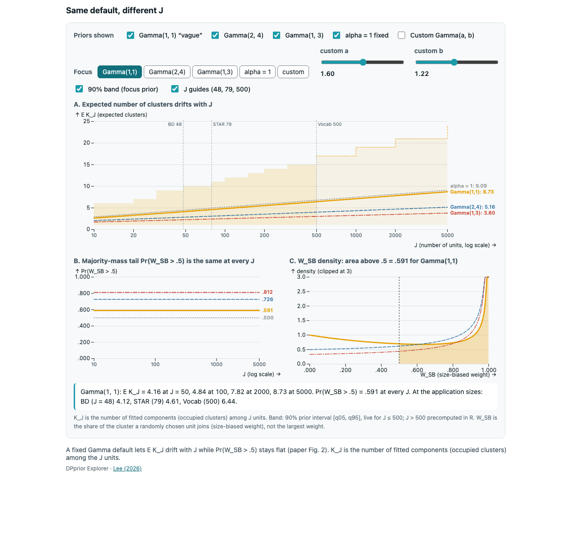
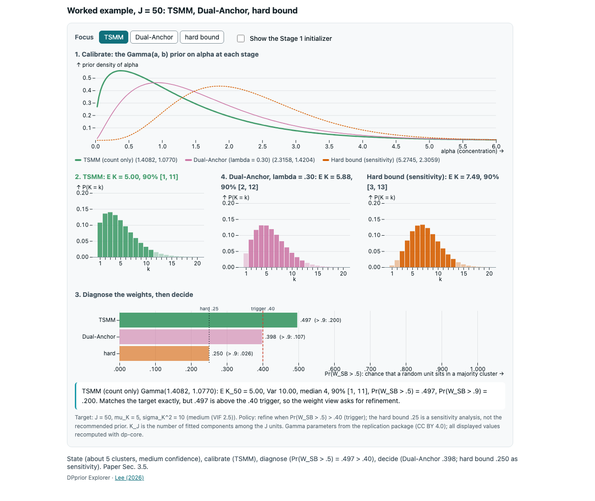
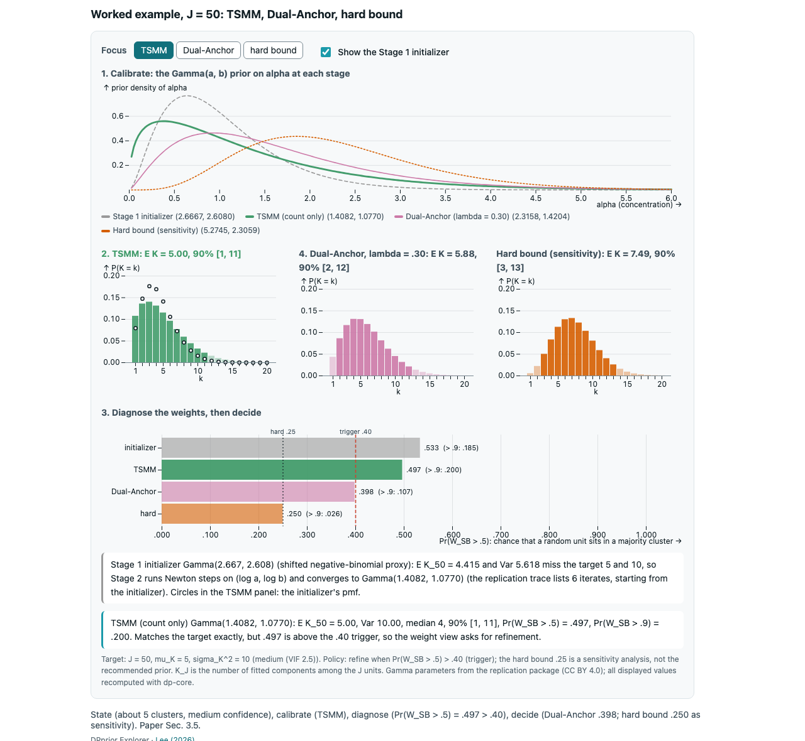
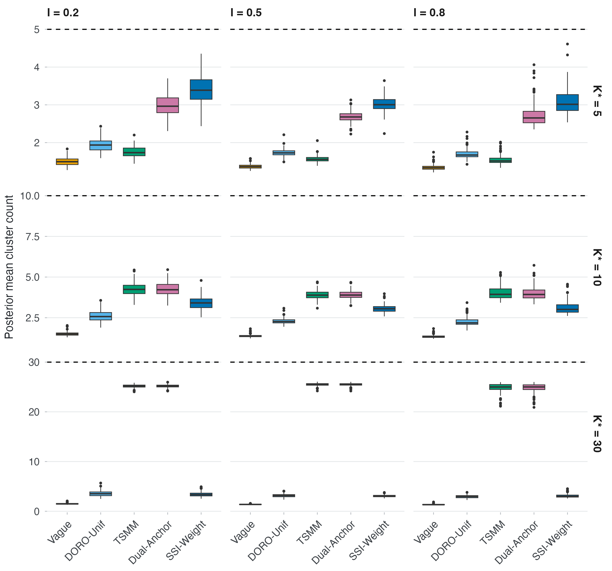
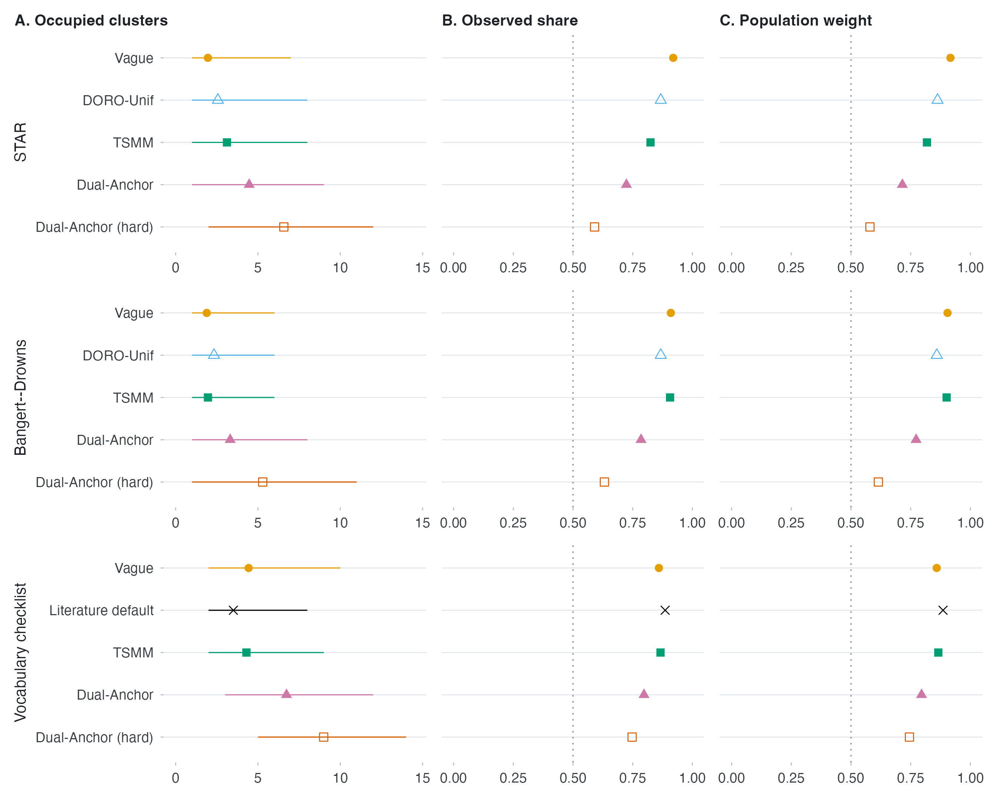

If a widget cannot run (no JavaScript, a locked-down laptop, a projector machine with an
old browser), these images carry the same message. Each was captured from the widget's
standalone page opened as a local file (`file://`) in headless Chrome.

## Stick-breaking (P-05): alpha 0.5, 2, 10

![alpha = 0.5: E[w1] = .667, Pr(w1 > .5) = .707; the first piece takes most of the stick.](../../media/fallback/P-05_alpha-0.5.png){fig-alt="Stick-breaking staircase with alpha 0.5"}

![alpha = 2: E[w1] = .333, Pr(w1 > .5) = .250.](../../media/fallback/P-05_alpha-2.png){fig-alt="Stick-breaking staircase with alpha 2"}

![alpha = 10: E[w1] = .091, Pr(w1 > .5) = .001; many small pieces.](../../media/fallback/P-05_alpha-10.png){fig-alt="Stick-breaking staircase with alpha 10"}

## Same default, different J (M-01, M-02)

{fig-alt="Expected clusters against J for default hyperpriors"}

## The unintended prior (M-03)

![Gamma(1.60, 1.22), J = 50: E K = 5.05, SD 3.06, 90% [1, 11]; Pr(W_SB > .5) = .487, Pr(W_SB > .9) = .183.](../../media/fallback/M-03_fig1.png){fig-alt="Count view and weight view of Gamma(1.60, 1.22) at J = 50"}

## Worked example, J = 50 (C-15)

{fig-alt="Worked example strip"}

{fig-alt="Worked example with the initializer"}

## From the paper

{fig-alt="Paper Figure 4"}

{fig-alt="Paper Figure 7"}

::: {.callout-note appearance="simple"}
K_J is the number of fitted components (occupied clusters) among the J units. The widget
images show prior quantities; Figures 4 and 7 show posterior summaries. Source of the
paper figures: joonho112/DPprior-paper-replication, `outputs/main/main-figure-4.png` and
`main-figure-7.png` (CC BY 4.0).
:::

## Embedding widgets in slides (A-15)

A proof-of-concept reveal.js deck tested five ways to put a widget on a slide, opening the
files from `file://` in Chrome:

| Path | Offline from a local folder |
|---|---|
| Live widget: load `js/vendor/d3.min.js`, `js/vendor/plot.min.js` and `js/bundles/<name>.js`, then call `DPX["<name>"].mountWidget(el, spec)` | works |
| Local iframe of `embed/<name>.html?...` | works |
| Video (`media/stick_alpha.mp4`) | works |
| Inline Quarto `{ojs}` cell | needs a local web server; Quarto disables OJS on `file://` |
| GitHub Pages iframe | needs the network |

A network audit with Chrome's net log found no remote requests from the deck except the
Pages slide. The standalone pages accept a preset in the query string, for example
[`embed/stick-breaking.html?alpha=0.5`](../../embed/stick-breaking.html?alpha=0.5).
